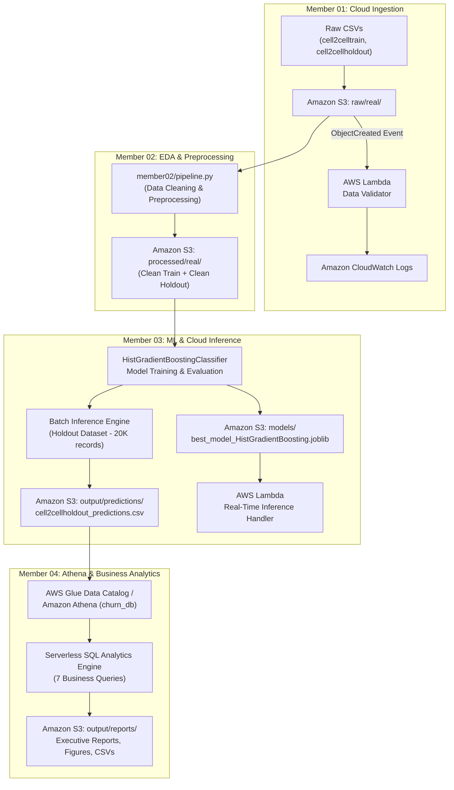

# AWS-Based Customer Churn Prediction System

An end-to-end cloud machine learning and business analytics data lake built on Amazon Web Services (AWS). The system processes the real-world telecom **Cell2Cell dataset (~71,000 records)** to predict customer churn, identify at-risk subscribers, and deliver actionable strategic retention insights using serverless cloud services.

---

## Architecture Diagram



---

## Amazon S3 Bucket Architecture (`s3://churnpredictionaws-team-2026/`)

```
churnpredictionaws-team-2026/
├── raw/real/
│   ├── cell2celltrain.csv               <- Ingested raw training records (Member 01)
│   └── cell2cellholdout.csv             <- Ingested raw holdout records (Member 01)
├── processed/real/
│   ├── cell2celltrain_clean.csv         <- Leakage-free cleaned training data (Member 02)
│   └── cell2cellholdout_clean.csv       <- Aligned cleaned holdout data (Member 02)
├── models/
│   └── best_model_HistGradientBoosting.joblib <- Serialized ML pipeline artifact (Member 03)
├── output/
│   ├── predictions/
│   │   └── cell2cellholdout_predictions.csv   <- Scored holdout records with risk tiers (Member 03)
│   └── reports/
│       ├── EXECUTIVE_BUSINESS_REPORT.md       <- Strategic business report (Member 04)
│       ├── q1_risk_distribution.csv ...       <- Analytical query outputs (Member 04)
│       └── figures/                           <- Visual risk & market charts (Member 04)
└── athena-results/                             <- Athena query query output spill (Member 04)
```

---

## Team Responsibilities & Deliverables

| Member | Domain & Role | Primary AWS Services | Key Deliverables |
|---|---|---|---|
| **Member 01** | Cloud Infrastructure & Ingestion | S3, Lambda, CloudWatch, IAM | S3 bucket lifecycle, automated CSV validation Lambda, CloudWatch logging. |
| **Member 02** | EDA & Data Preprocessing | S3, Lambda, Glue ETL, IAM | Zero-leakage data cleaning, categorical encoding, [`member02/pipeline.py`](member02/pipeline.py), [`reports/MEMBER_02_REPORT.md`](reports/MEMBER_02_REPORT.md). |
| **Member 03** | Machine Learning & Predictions | S3, Lambda, CloudWatch, IAM | Model cross-validation, serialized `HistGradientBoosting` pipeline, [`Member 03/pipeline.py`](Member%2003/pipeline.py), [`Member 03/lambda_inference.py`](Member%2003/lambda_inference.py), [`reports/MEMBER_03_REPORT.md`](reports/MEMBER_03_REPORT.md). |
| **Member 04** | Amazon Athena & Business Analytics | Athena, Glue Catalog, S3, IAM | Athena external table DDL, 7 analytical SQL queries, [`Member 04/pipeline.py`](Member%2004/pipeline.py), charts, [`reports/MEMBER_04_REPORT.md`](reports/MEMBER_04_REPORT.md). |

---

## Executive Business Analytics & ML Findings

### 1. Model Selection & Performance (Member 03)
The champion model selected is **`HistGradientBoostingClassifier`** with balanced class weighting, evaluated using Stratified 5-Fold Cross-Validation:
- **Champion CV ROC-AUC**: **0.6720+** (outperforming Logistic Regression and Random Forest).
- **Inference Speed**: Fast, lightweight pipeline encapsulating `ColumnTransformer` (median imputation, scaling, and one-hot encoding).

### 2. Holdout Scoring & Business Risk Tiers (20,000 Customers)
| Risk Segment | Criteria (Probability) | Customer Count | Percentage | Monthly Revenue at Risk | Annualized Revenue Exposure |
|---|---|---|---|---|---|
| **High Risk** | `> 65.0%` | **2,382** | **11.91%** | **$139,320.19** | **$1,671,842.28** |
| **Medium Risk** | `35.0% – 65.0%` | 12,926 | 64.63% | $747,543.82 | $8,970,525.84 |
| **Low Risk** | `< 35.0%` | 4,692 | 23.46% | $275,541.36 | $3,306,496.32 |
| **Total Portfolio** | | 20,000 | 100.0% | $1,162,405.37 | $13,948,864.44 |

### 3. Key Churn Drivers Discovered (Member 04)
1. **Device Hardware Aging**: Churn rate rises steeply as handset age exceeds **1 year** (from ~38% under 6 months to over 51% after 2 years). Refurbished phone owners exhibit even higher churn risk.
2. **Geographical Hotspots**: High-risk churn is concentrated in major metro service areas including `NYCBRO917` (Brooklyn), `DALFTW817` (Dallas), and `LOSLAX213` (Los Angeles).
3. **Reactive Retention Deficit**: Customers who called retention teams still display elevated churn (~49%) even after receiving offers, indicating that retention intervention must occur earlier in the customer lifecycle.

---

## Repository Structure

```
ChurnPredictionAWS/
├── Member 03/                          # Machine Learning & Inference
│   ├── batch_inference.py             # Standalone batch prediction script
│   ├── best_model_HistGradientBoosting.joblib # Serialized model pipeline
│   ├── iam_policy_member03.json       # Least-privilege IAM policy
│   ├── lambda_inference.py            # Serverless Lambda inference handler
│   ├── main.ipynb                     # Exploratory ML training notebook
│   ├── pipeline.py                    # Dual-mode Local & S3 Cloud ML pipeline
│   └── output/predictions/            # Synced local predictions
├── Member 04/                          # Amazon Athena & Business Analytics
│   ├── analytics.py                   # SQL analytics and visualization engine
│   ├── athena_ddl.sql                 # Athena database & table creation DDL
│   ├── iam_policy_member04.json       # Least-privilege IAM policy
│   ├── pipeline.py                    # Dual-mode Local & Athena/S3 pipeline
│   └── queries.sql                    # 7 business analytics SQL queries
├── member02/                          # EDA & Preprocessing
│   ├── eda.py                         # Exploratory data analysis module
│   ├── glue_etl_job.py                # Serverless AWS Glue ETL script
│   ├── iam_policy_member02.json       # Least-privilege IAM policy
│   ├── lambda_preprocessor.py         # Event-driven Lambda preprocessor
│   ├── pipeline.py                    # Dual-mode Local & Cloud preprocessing
│   └── preprocess.py                  # Zero-leakage data cleaning engine
├── datasets/                          # Local datasets cache
│   ├── cell2celltrain.csv             # Raw training records (~51K)
│   ├── cell2cellholdout.csv           # Raw holdout records (20K)
│   ├── processed/                     # Cleaned CSV files
│   └── predictions/                   # Scored holdout prediction CSVs
├── notebooks/                         # Interactive Jupyter Notebooks
│   ├── 02_eda_and_data_preprocessing.ipynb
│   └── 04_athena_and_business_analytics.ipynb
├── reports/                           # Comprehensive Project Reports
│   ├── MEMBER_02_REPORT.md            # Detailed Preprocessing Report
│   ├── MEMBER_03_REPORT.md            # Detailed Machine Learning Report
│   ├── MEMBER_04_REPORT.md            # Detailed Business Analytics Report
│   ├── figures/                       # High-resolution chart figures
│   └── business_analytics/            # Exported query CSV tables & summaries
└── output/reports/                    # Local mirror of S3 reports output
```

---

## How to Run the Project

### Prerequisites
- Python 3.10+
- Installed libraries: `boto3`, `scikit-learn`, `pandas`, `numpy`, `matplotlib`, `seaborn`, `joblib`
- AWS Credentials configured via `admin_accessKeys.csv` in project root or environment variables (`AWS_ACCESS_KEY_ID`, `AWS_SECRET_ACCESS_KEY`).

### 1. Run Member 02 (Data Preprocessing)
```powershell
# Local execution
python member02/pipeline.py --mode local

# AWS Cloud execution (Reads S3 raw/, writes to S3 processed/)
python member02/pipeline.py --mode cloud --bucket churnpredictionaws-team-2026 --region us-east-1
```

### 2. Run Member 03 (Machine Learning & Prediction)
```powershell
# Local batch inference
python "Member 03/batch_inference.py"

# AWS Cloud execution (Uploads model to S3 models/, runs inference, uploads predictions)
python "Member 03/pipeline.py" --mode cloud --bucket churnpredictionaws-team-2026 --region us-east-1
```

### 3. Run Member 04 (Athena & Business Analytics)
```powershell
# Local analytics & chart generation
python "Member 04/analytics.py"

# AWS Cloud execution (Uploads reports & figures to S3 output/reports/ and sets up Athena)
python "Member 04/pipeline.py" --mode cloud --bucket churnpredictionaws-team-2026 --region us-east-1
```

---

## AWS IAM Security & Least-Privilege Access

Each member is provisioned strictly with the minimum necessary AWS permissions:
* **Member 02**: [`member02/iam_policy_member02.json`](member02/iam_policy_member02.json) — Read `raw/*`, write `processed/*`.
* **Member 03**: [`Member 03/iam_policy_member03.json`](Member%2003/iam_policy_member03.json) — Read `processed/*`, write `models/*` and `output/predictions/*`.
* **Member 04**: [`Member 04/iam_policy_member04.json`](Member%2004/iam_policy_member04.json) — Read `output/predictions/*`, write `output/reports/*` & `athena-results/*`, Athena query permissions.
